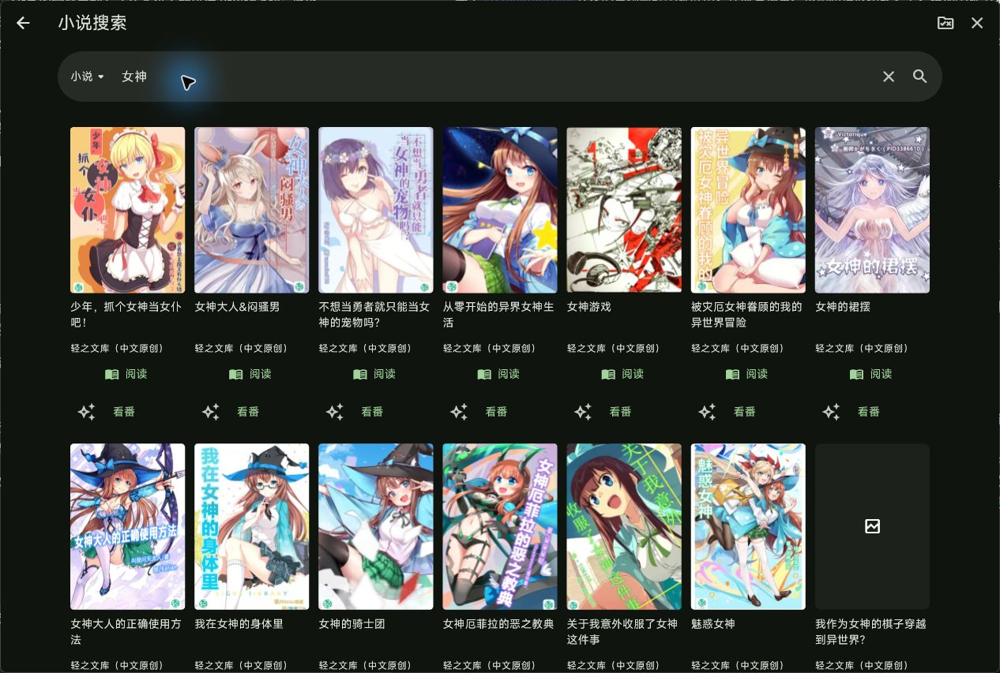
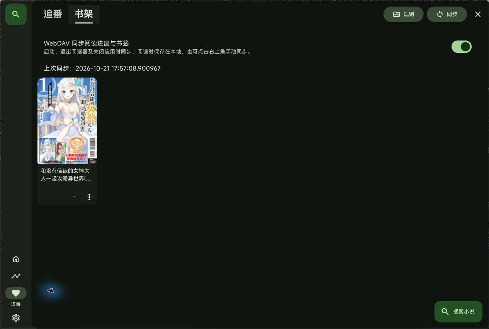
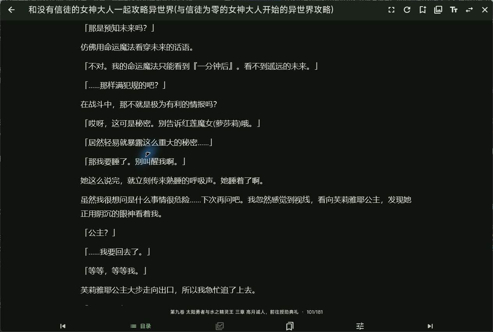
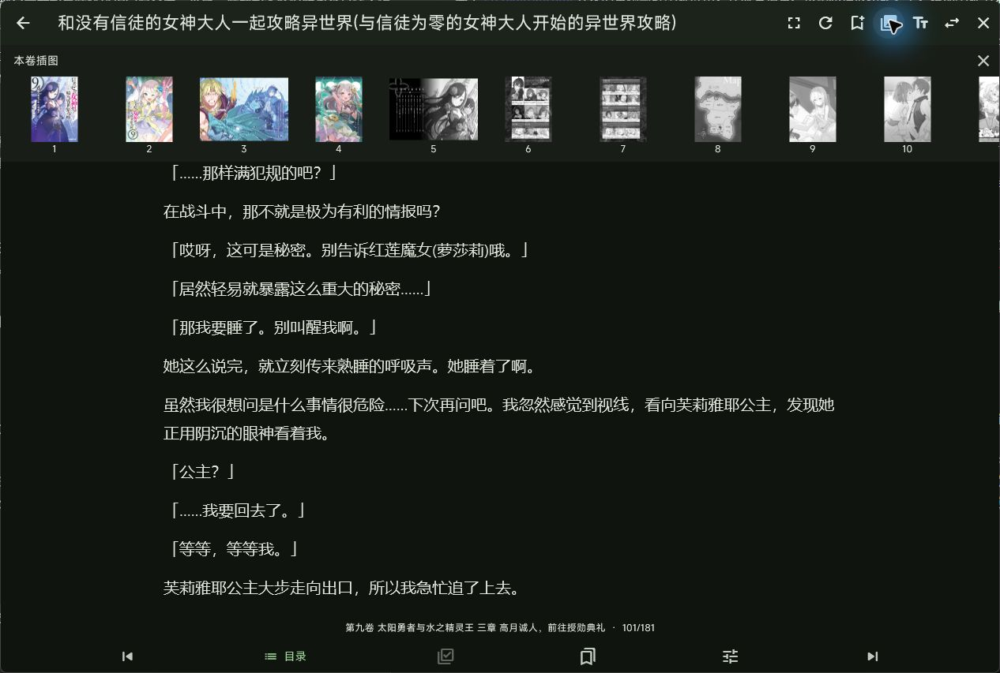

<h1>Kazumi's book</h1>

基于 [Predidit/Kazumi](https://github.com/Predidit/Kazumi) 开发的番剧与轻小说应用，在原有追番、搜索和播放功能之上，增加小说书架、阅读器、作品关联与阅读进度同步。

这是由 [ZGCC3890](https://github.com/ZGCC3890) 维护的独立衍生项目，不是官方 Kazumi 发行版。开发分支：[`feature/novel-reader`](https://github.com/ZGCC3890/Kazumi-s-book/tree/feature/novel-reader)。

[下载应用](https://github.com/ZGCC3890/Kazumi-s-book/releases/latest) · [使用与同步](#小说使用) · [小说规则](novel_rules/README.md) · [版本说明](CHANGELOG.md) · [参与贡献](CONTRIBUTING.md)

</img>

</img>
</img>

使用 Flutter 开发。看番与阅读相互关联，书源规则独立管理，阅读位置保存在本机，并可通过自己的 WebDAV 在设备间同步。

## 项目特色

- **番剧与小说关联**：从追番条目续读小说，或从小说卡片查找对应番剧；可主动使用 AI 查询不同译名。
- **多书源搜索与书架**：按来源展示封面卡片，直接阅读、换源、加入或移出书架。
- **原生阅读器**：滚动与翻页、字体与主题、目录定位、书签、插图独立加载；有独立插图章时提供可收起的插图栏。
- **跨设备进度**：本地保存，按启动、退出阅读器和退出应用等事件同步；同源并发进度保留更远位置，跨源冲突由用户选择。
- **独立安装**：Android 包名 `com.zgcc.kazumisbook`；Windows 程序 `kazumis_book.exe`，使用独立数据目录。更新来自本仓库，可与官方 Kazumi 共存。

## 安装与更新

从 [Releases](https://github.com/ZGCC3890/Kazumi-s-book/releases/latest) 下载与平台对应的文件，可使用同页的 `SHA256SUMS.txt` 校验完整性。

| 平台 | 发行文件 | 安装方式 |
| --- | --- | --- |
| Android 10+，arm64 | APK | 安装 APK；本项目相同正式签名的版本支持覆盖升级。 |
| Windows 10+，x64 | ZIP | 完整解压到有写入权限的目录，运行 `kazumis_book.exe`；可放在 D 盘等自定义目录。 |

从 0.1.8 起，Windows 下载校验后点击“立即安装”，会将文件替换到**正在运行的程序目录**，关闭前保存并同步阅读进度，更新完成后重新打开。系统临时目录仅用于下载和解压，不决定安装位置。0.1.7 及更早发行版尚无这一自动替换流程，首次升级需退出程序后，将新版 ZIP 完整解压覆盖原程序目录。更新或手动覆盖时保留完整的 `data/` 和 DLL 文件。

macOS、Linux、iOS 等平台目录继承自上游，本分支目前不发布这些平台的安装包，也不将它们列为已验证的平台。上游各平台支持情况见 [Kazumi](https://github.com/Predidit/Kazumi)。

## 小说使用

以下说明对应当前开发分支；发行包功能以对应版本说明为准。

- 在搜索栏切换“番剧／小说”。两种搜索共用历史记录，无痕模式不保存历史。小说结果按书源分别显示为封面卡片，点击封面或“阅读”直接打开该源；点击“看番”查询关联番剧并进入选源播放。已绑定小说的番剧阅读按钮直接续读。
- 在“追番”旁切换到“书架”。书架以封面卡片展示小说，卡片菜单可以更换书源或删除书籍。删除只移出书架，保留本地阅读位置和书签。
- 阅读器支持滚动、翻页、目录、书签及插图缩放。点击正文中间以滑入动画显示或隐藏覆盖工具栏，正文不位移；打开目录定位到当前章。右上角可更换书源，底部可加入书架；Windows 支持拖动顶部栏、F11 全屏和 Esc 退出。在阅读设置中调整字体、行距、页边距、纸色与屏幕方向；明暗跟随应用主题。
- 当前卷有独立插图章时，书签旁显示插图栏开关。展开后按章节及图片原顺序横向浏览，点击缩略图可放大；展开、收起及查看图片保持正文阅读位置，切卷时更新为当前卷的插图。首次展开后才读取插图章，不根据正文中的插图编号猜测位置。
- 默认书源在首次使用时获取。需要登录的书源通过“书源账号”登录；验证成功后账号密码加密保存在本机，会话过期时自动登录，清除登录会删除本机凭据。添加、更新规则和登录要求见[小说规则说明](novel_rules/README.md)。
- 在“设置 → AI 作品关联”依次选择供应商、模型，再填写 API Key 并启用。供应商和模型列表支持搜索，内置选项会自动填写接口地址及模型 ID；其他兼容 Chat Completions 的接口可选择“自定义”。默认使用 DeepSeek，联网检索要求服务支持 DeepSeek Search 协议；切换到其他内置供应商时默认关闭联网检索，并清空旧 API Key。番剧首次选择小说、小说卡片的“AI 关联番剧”及换源搜索框旁的“AI 搜索”会提供候选名称，选择后查询实际来源。未启用时保留原有名称和别名匹配。AI 配置只保存在本机。

## WebDAV 同步

在“设置 → 多设备同步”填写服务器地址、用户名和密码，保存并测试连接后启用 WebDAV 和小说同步。阅读过程中只保存到本地；启动应用、退出阅读器和正常关闭桌面应用时自动同步，也可点击“立即同步小说”或书架右上角同步按钮。Android 在退到后台时触发一次；操作系统直接终止进程时无法保证最后一次网络传输完成。

同一本书、同一书源的并发进度按书源目录顺序保留更靠后的章节，同章比较阅读位置，位置相同时使用较新的记录；不同书源、不同书籍或无法对应的章节保留候选供用户选择。已同步之后主动回读较早章节属于新的阅读记录，不会被强制改回更远位置。

导入官方 Kazumi 的已有观看记录时，填写原来相同的 WebDAV 基址，启用“观看记录”并点击“立即同步观看记录”。应用自动使用基址下的 `kazumiSync/`，不要在基址中重复填写这个目录。小说数据位于 `kazumiSync/novels/`，仅支持小说的客户端会使用它；书源账号、规则、正文和图片缓存不随小说进度同步。

Nextcloud 地址格式为 `https://你的域名/remote.php/dav/files/登录ID/指定目录/`。目录名含中文时直接填写中文并保留末尾 `/`，不要预先转换为百分号编码。密码使用 Nextcloud“个人设置 → 安全 → 设备和会话”生成的应用密码。

## 屏幕截图

下方为本项目 Windows 界面的实际运行截图；书籍封面和内容来自用户配置的第三方书源。

<table>
  <tr>
    <td width="50%"> 小说搜索与作品关联</td>
    <td width="50%"> 书架与进度同步</td>
  </tr>
  <tr>
    <td> 阅读器与阅读工具</td>
    <td> 可收起的插图栏</td>
  </tr>
</table>

## 继承的番剧功能

- [X]  规则编辑器
- [X]  番剧目录
- [X]  番剧搜索
- [X]  番剧时间表
- [X]  番剧字幕
- [X]  分集播放
- [X]  视频播放器
- [X]  多视频源支持
- [X]  规则分享
- [X]  硬件加速
- [X]  高刷适配
- [X]  追番列表
- [X]  番剧弹幕接口（构建时需配置本应用的弹弹play凭据）
- [X]  在线更新
- [X]  历史记录
- [X]  倍速播放
- [X]  配色方案
- [X]  跨设备同步
- [X]  无线投屏 (DLNA)
- [X]  外部播放器播放
- [X]  超分辨率
- [X]  一起看
- [X]  番剧下载
## 贡献

问题和功能建议请提交到[本仓库 Issues](https://github.com/ZGCC3890/Kazumi-s-book/issues)，贡献代码前阅读 [CONTRIBUTING.md](CONTRIBUTING.md)。小说规则在 [novel_rules/](novel_rules/README.md) 维护；番剧规则沿用上游 [KazumiRules](https://github.com/Predidit/KazumiRules)，格式与小说规则不同。

## Q&A

使用者 Q&A

#### Q: 为什么少数番剧中有广告？

A: 本项目未插入任何广告。广告来自视频源, 请不要相信广告中的任何内容, 并尽量选择没有广告的视频源观看。

#### Q: 为什么我启用超分辨率功能后播放卡顿？

A: 超分辨率功能对 GPU 性能要求较高, 如果没有在高性能独立显卡上运行 Kazumi, 尽量选择效率档而非质量档。对低分辨率视频源而非高分辨率视频源使用超分也可以降低性能消耗。

#### Q: 为什么播放视频时内存占用较高？

A: 本程序在视频播放时, 会尽可能多地缓存视频到内存, 以提供较好的观看体验。如果您的内存较为紧张, 可以在播放设置选项卡启用低内存模式, 这将限制缓存。

#### Q: 为什么少数番剧无法通过外部播放器观看？

A: 部分视频源的番剧使用了反盗链措施, 这可以被 Kazumi 解决, 但无法被外部播放器解决。

#### Q: 官方 Kazumi 和本项目的同步数据兼容吗？

A: 观看记录和收藏沿用官方协议，使用原有 WebDAV 基址即可。小说数据位于独立子目录，官方 Kazumi 不支持阅读或编辑这些数据。请先在原客户端完成同步，再在本项目启用对应同步项。

规则编写者 Q&A

#### Q: 为什么我的自定义规则无法实现检索？

A: 目前我们对 `Xpath` 语法的支持并不完整, 我们目前只支持以 `//` 开头的选择器。建议参照我们给出的示例规则构建自定义规则。

#### Q: 为什么我的自定义规则可以实现检索, 但不能实现观看？

A: 尝试关闭自定义规则的使用内置播放器选项, 这将尝试使用 `webview` 进行播放, 提高兼容性。但在内置播放器可用时, 建议启用内置播放器, 以获得更加流畅并带有弹幕的观看体验。

开发者 Q&A

#### Q: 我在尝试自行编译该项目, 但编译没有成功。

A: 本项目编译需要良好的网络环境, 除了由 Google 托管的 Flutter 相关依赖外, 本项目同样依赖托管在 MavenCentral/Github/SourceForge 上的资源。如果您位于中国大陆, 可能需要设置恰当的镜像地址。

Windows 构建需要 Visual Studio 的 C++ 桌面开发工具及匹配工具集的 ATL 组件。Linux 构建还需要系统密钥环开发库，Debian/Ubuntu 对应 `libsecret-1-dev`；书源账号的安全存储由系统提供。

## 开发

环境准备、构建及测试命令见 [贡献指引](CONTRIBUTING.md)，模块职责见 [项目结构](static/doc/STRUCTURE.md)。公开文档说明产品和贡献方式；版本变化记录在 [CHANGELOG.md](CHANGELOG.md)。

## 美术资源

本项目图标来自 [Yuquanaaa](https://www.pixiv.net/users/66219277) 发表在 [Pixiv](https://www.pixiv.net/artworks/116666979) 上的作品。

图标版权属于原作者。上游声明已取得其用于 Kazumi 的授权；本分支保留该来源说明，不将上游授权表述为本分支另行取得的授权。图标不因代码采用 GPL 而自动成为可自由使用的素材，再分发或另作他用时须核对原作者许可。

本项目内嵌字体为 [Mi Sans](https://hyperos.mi.com/font/zh/details/sc/) 字体, 由 [Xiaomi](https://www.mi.com/index.html) 开发和拥有版权。

## 开源许可与上游来源

本项目由 [Predidit/Kazumi](https://github.com/Predidit/Kazumi) 衍生，保留上游作者及贡献者的署名，新增小说模块和本分支集成修改由本项目贡献者维护。代码继续按 [GNU GPL 第 3 版](LICENSE) 发布；修改和发行日期见 [版本说明](CHANGELOG.md)，每个发行版的源码可通过同名 Git 标签获取。

分发修改版时应保留适用的版权和许可声明，标明修改，并按 GPL 要求提供相应源码。第三方库、图标、字体及站点内容按各自条款使用，详情见 [第三方声明](THIRD_PARTY_NOTICES.md)。GPL 原文保持不变。

## 使用说明与责任

本项目基于 GNU 通用公共许可证第 3 版（GPL-3.0）授权。我们不对其适用性、可靠性或准确性作出任何明示或暗示的保证。在法律允许的最大范围内, 作者和贡献者不承担任何因使用本软件而产生的直接、间接、偶然、特殊或后果性的损害赔偿责任。

本应用按用户配置的规则访问第三方网站，不托管番剧或小说内容。请遵守内容来源的条款和适用法律，取得所需授权；代码许可证不授予第三方作品的版权许可。

## 隐私政策

阅读进度、设置及账号凭据保存在本机；启用 WebDAV 后向用户指定服务器同步，主动调用 AI 关联时向所选供应商发送查询内容。外部书源、Bangumi 等服务会接收完成请求所需的信息。具体数据范围见 [隐私说明](PRIVACY.md)。

## 发行与身份

Android 正式版使用本项目固定签名。Windows 以 ZIP 发布，不继承上游的 SignPath 签名或赞助关系。安装包和源码只以本仓库对应版本为准；请将本分支的问题反馈给本仓库维护者。

## 致谢

感谢 [Predidit/Kazumi](https://github.com/Predidit/Kazumi) 及其[贡献者](https://github.com/Predidit/Kazumi/graphs/contributors)提供项目基础，以及[本分支贡献者](https://github.com/ZGCC3890/Kazumi-s-book/graphs/contributors)持续改进小说与番剧体验。

特别感谢 [XpathSelector](https://github.com/simonkimi/xpath_selector) 这个优秀的项目是本项目的基石。

特别感谢 [弹弹play](https://www.dandanplay.com/) 本项目使用了 弹弹play开放平台 以提供弹幕交互。

特别感谢 [Bangumi](https://bangumi.tv/) 本项目使用了 Bangumi 开放 API 以提供番剧元数据。

特别感谢 [Anime4K](https://github.com/bloc97/Anime4K) 本项目使用 Anime4K 进行实时超分。

特别感谢 [SyncPlay](https://github.com/Syncplay/syncplay) 本项目使用 SyncPlay 协议并通过 SyncPlay 公共服务器实现一起看功能。

特别感谢 [trace.moe](https://trace.moe) 本项目使用了 trace.moe 提供的图片识别番剧功能。

感谢 [media-kit](https://github.com/media-kit/media-kit) 本项目跨平台媒体播放能力来自 media-kit。

感谢 [avbuild](https://github.com/wang-bin/avbuild) 本项目使用了来自 avbuild 的树外补丁实现非标准视频流播放。

感谢 [hive](https://github.com/isar/hive) 本项目持久化储存能力来自 hive。
